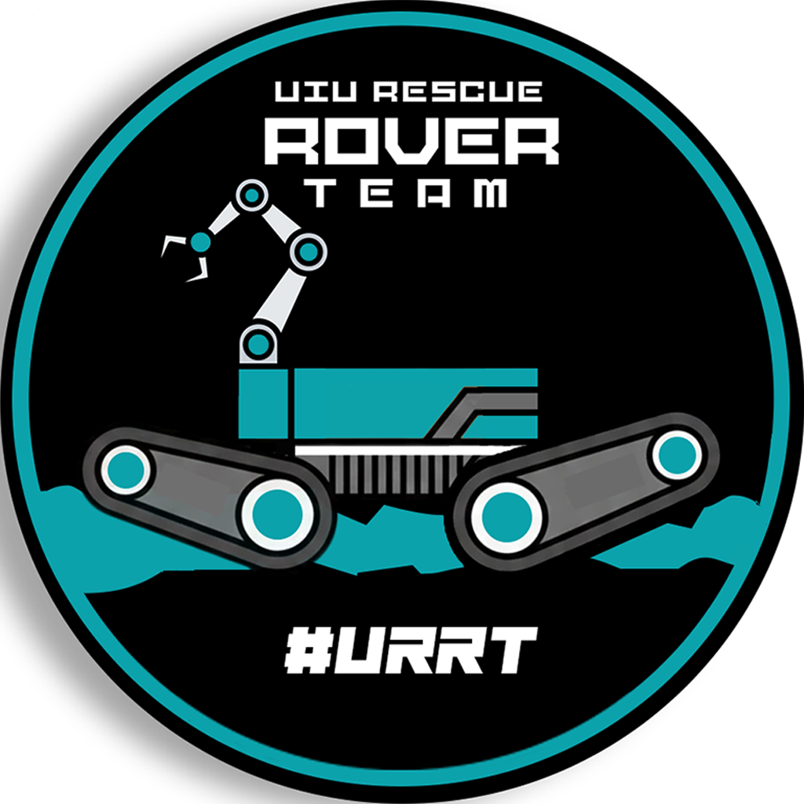

# 🛰️ URRT Task Board

**Mission-critical task management platform for the UIU Rescue Rover Team.**



URRT Task Board is a lightweight task and team management platform built for the **UIU Rescue Rover Team (#URRT)**. It helps engineering teams organize tasks, coordinate subteams, monitor deadlines, track important dates, and maintain a clear overview of ongoing operations.

The project has been extensively customized, extended, and developed into a multi-platform application with a focus on usability, reliability, and practical team collaboration.

---

## 🚀 Key Features

### 🔐 Access Control & Team Management
- **Team Join Code:** Restricts board access to authorized team members.
- **Team Lead Access:** Dedicated management interface for team administration.
- **Role-Based Permissions:** Separates administrative operations from member-level access.
- **Team Configuration:** Manage team information and board settings.

### 📋 Task Management
- **Task Creation & Assignment:** Create tasks, assign owners, and organize work.
- **Subteam Organization:** Separate tasks into specialized teams such as Software, Mechanical, and Electrical.
- **Priority Management:** Organize tasks by Critical, High, Medium, and other priority levels.
- **Deadline Tracking:** Monitor upcoming, overdue, and completed tasks.
- **Task Finder:** Quickly locate tasks using available filters.
- **Assigned By Tracking:** Identify the Team Lead responsible for assigning each task.

### 📅 Important Dates
- Maintain a centralized calendar of important team events.
- Add event names, dates, locations, and descriptions.
- Track preparation status and completion progress.
- View countdowns to upcoming events.
- Manage important dates independently from regular tasks.

### 🚨 Dynamic Alert System
- Automatically highlights critical and overdue tasks.
- Provides visual progress indicators.
- Uses motivational messages and GIF-based elements to keep the team engaged.

### 📊 Activity & Progress Monitoring
- Activity logs for tracking task-related changes.
- Subteam-level task organization.
- Visual indicators for task status and deadlines.
- Centralized overview of team progress.

### 💾 Data Persistence
- Local-first data storage.
- Persistent Android application storage.
- Backup and restore support.
- Cloud synchronization architecture using Supabase is under development.

---

## 📱 Platforms

URRT Task Board is designed to support multiple access environments:

| Platform | Technology |
|---|---|
| Android Tablet | Android WebView application |
| Web Browser | HTML, CSS & JavaScript |
| Cloud Backend | Supabase (integration in progress) |

The Android application is designed to support older Android devices, including legacy WebView environments.

---

## 🛠️ Tech Stack

- **Frontend:** HTML5, CSS3, Vanilla JavaScript
- **Android:** Java, Android WebView
- **Storage:** LocalStorage, SharedPreferences
- **Backend / Cloud:** Supabase PostgreSQL, Authentication and Realtime (integration in progress)
- **Version Control:** Git & GitHub
- **Build Automation:** GitHub Actions

---

## 📦 Project Deployment

### Web Deployment
1. Push the project to a GitHub repository.
2. Open repository **Settings → Pages**.
3. Select the `main` branch.
4. Choose the root directory.
5. Deploy the web application.

### Android Build
The Android application can be built using Gradle.

```bash
gradle assembleDebug
```

The debug APK is generated at:

```text
app/build/outputs/apk/debug/app-debug.apk
```

GitHub Actions can also be used to automate APK builds.

---

## 🔄 Development Roadmap

- [ ] Task management system
- [ ] Subteam organization
- [ ] Task priority and deadline tracking
- [ ] Important Dates management
- [ ] Android application
- [ ] Persistent local storage
- [ ] Supabase cloud database integration
- [ ] Live synchronization between Android and web devices
- [ ] Secure cloud-based role management

---

## 👨‍💻 Development & Credits

**Developed and maintained by:**

### Shriful Islam (InHumanZ)

Responsible for the project's current development, feature implementation, UI/UX customization, Android application development, integration, and ongoing maintenance.

**Original inspiration / codebase credit:**

Athin — original project and codebase that inspired the development of URRT Task Board.

This project has since been substantially customized and extended to meet the operational requirements of the UIU Rescue Rover Team.

---

## 🌐 UIU Rescue Rover Team

Developed for the **United International University Rescue Rover Team (#URRT)**.

Website: [rescuerover.uiu.ac.bd](http://rescuerover.uiu.ac.bd)

---

**URRT Task Board · Built for the mission.**